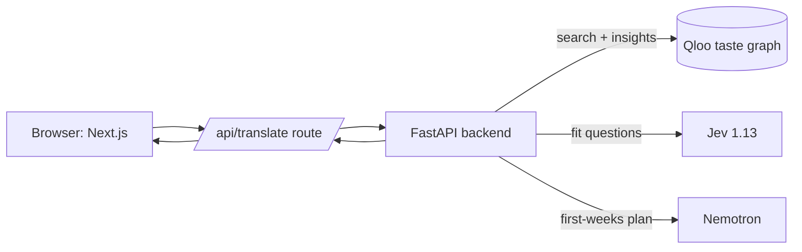

# Homecoming

**Your taste didn't move. Your address did.**

Homecoming helps people who move to a new city rebuild their sense of what's good. Name a café, band or film you loved back home, and Homecoming finds what people with your taste love in your new city, shows the traits you share, and gives each match a fit score.

Built for the Qloo LLM Hackathon.

**Live demo:** https://homecoming-web.vercel.app/

---

## What it does

1. **You tell it two cities and a few favourites.** For example: left Pune, moved to Toronto, loved a bakery, an artist and a film.
2. **Qloo's taste graph finds the equivalents.** Each favourite is resolved to a Qloo entity, then Qloo returns the places (or music and films) people with that taste love in the new city.
3. **Every match is explained.** The app shows the Qloo tags the match shares with your original, so you can judge it yourself.
4. **Jev scores the fit.** Jev (TypeSafe's System One model) answers fast yes/no-probability questions about each pair and the average becomes a fit score from 0 to 100.
5. **A language model writes a first-weeks plan.** Nemotron turns the matches into a short, concrete plan. It may only use the matched places and shared tags, so it cannot invent venues.

A language model alone can say "Toronto has great cafés." Only a taste graph can say which one is the equivalent of yours.

## How the three AI pieces fit together

| Piece | Job | Why it is the right tool |
|---|---|---|
| **Qloo** | Finds candidate matches from real taste data | Cultural taste across places, music and film, tied to a location |
| **Jev 1.13** | Scores how close each match is to the original | Fast, cheap, calibrated yes/no judgments instead of free text |
| **Nemotron** | Writes the first-weeks plan | Free-form writing, limited to the data above |



## Qloo API calls used

| Call | Purpose |
|---|---|
| `GET /search` | Turn a favourite (place, artist, film) into a Qloo entity. Places are searched together with the home city so a common name finds the right one. |
| `GET /v2/insights` with `filter.type=urn:entity:place`, `filter.location.query`, `signal.interests.entities` | Places in the new city whose fans share the taste of your original |
| `GET /v2/insights` with `signal.location.query` and an artist or film type | What people in the new city who like your artist or film also love |

## Tech stack

- **Frontend:** Next.js 14 (App Router), React 18, Tailwind CSS, lucide-react
- **Backend:** Python, FastAPI, httpx
- **AI:** Qloo API, Jev 1.13 via the `typesafe-sdk`, Nemotron over an OpenAI-compatible endpoint
- **Hosting:** Vercel (frontend) and Render (backend)

## Repository layout

```
Homecoming/
├── homecoming backend/    FastAPI app: Qloo, Jev and LLM logic
│   ├── app.py
│   ├── static/index.html  simple fallback page served by the backend
│   ├── requirements.txt
│   ├── Dockerfile
│   └── render.yaml
├── homecoming-web/        Next.js front end
│   ├── app/               pages and the /api/translate proxy route
│   ├── components/
│   ├── design/tokens.json design tokens (colour roles, type, spacing)
│   └── package.json
├── LICENSE
└── README.md
```

## Run it locally

You need Python 3.12+, Node 18+, a Qloo API key, and an OpenCode key (it powers both Jev and the language model).

**1. Backend**

```bash
cd "homecoming backend"
pip install -r requirements.txt
cp .env.example .env        # then fill in the keys (see below)
uvicorn app:app --reload    # http://localhost:8000
```

**2. Frontend** (in a second terminal)

```bash
cd homecoming-web
npm install
npm run dev                 # http://localhost:3000
```

The frontend calls `/api/translate`, which forwards to the backend at `BACKEND_URL` (default `http://localhost:8000`).

## Environment variables

**Backend** (`homecoming backend/.env`)

| Variable | Required | Purpose |
|---|---|---|
| `QLOO_API_KEY` | Yes | Qloo taste graph. Without it the app runs in clearly labelled demo mode. |
| `OPENCODE_API_KEY` | Recommended | One key for Jev fit scores and the Nemotron plan |
| `JEV_BASE_URL`, `JEV_MODEL` | No | Defaults: `https://opencode.ai/inference/systemone`, `jev-1.13-free` |
| `LLM_BASE_URL`, `LLM_MODEL` | No | Defaults: `https://opencode.ai/inference/openai/v1`, `nemotron-3.5-lightning-free` |
| `TYPESAFE_API_KEY` | No | Use Jev directly from TypeSafe instead of OpenCode |

Check `http://localhost:8000/healthz`. It reports whether Qloo, the language model and Jev are configured.

**Frontend** (Vercel project settings)

| Variable | Purpose |
|---|---|
| `BACKEND_URL` | Full `https://` address of the deployed backend |

Never commit real keys. `.env` files are ignored by git.

## Deploy

1. **Backend on Render:** create a Web Service from the `homecoming backend` folder (Docker). Add `QLOO_API_KEY` and `OPENCODE_API_KEY`.
2. **Frontend on Vercel:** import the repo, set the Root Directory to `homecoming-web`, add `BACKEND_URL` with the Render address, and deploy.

## Design

The interface follows a small design system in `homecoming-web/design/tokens.json`: warm paper background, deep green accent, an editorial serif for headings and a clean sans for text. Every text and background pair passes WCAG AA contrast. Focus states are visible, touch targets are at least 44px, and animations respect reduced-motion settings.

## Known limits

- Jev scores from Qloo's tag lists, not from the venues themselves. Treat the score as a grounded closeness estimate, not a review.
- Match quality depends on how well Qloo can resolve the favourite. Full names with the city work best.
- The free Jev and Nemotron tiers can be rate limited. If they fail, the app still shows the Qloo matches and shared tags.

## Acknowledgements

- [Qloo](https://qloo.com) for the taste graph and hackathon API
- [TypeSafe AI](https://typesafe.ai) for Jev
- Nemotron by NVIDIA, served through OpenCode

## License

[MIT](LICENSE) © 2026 Sushant Dhakane
